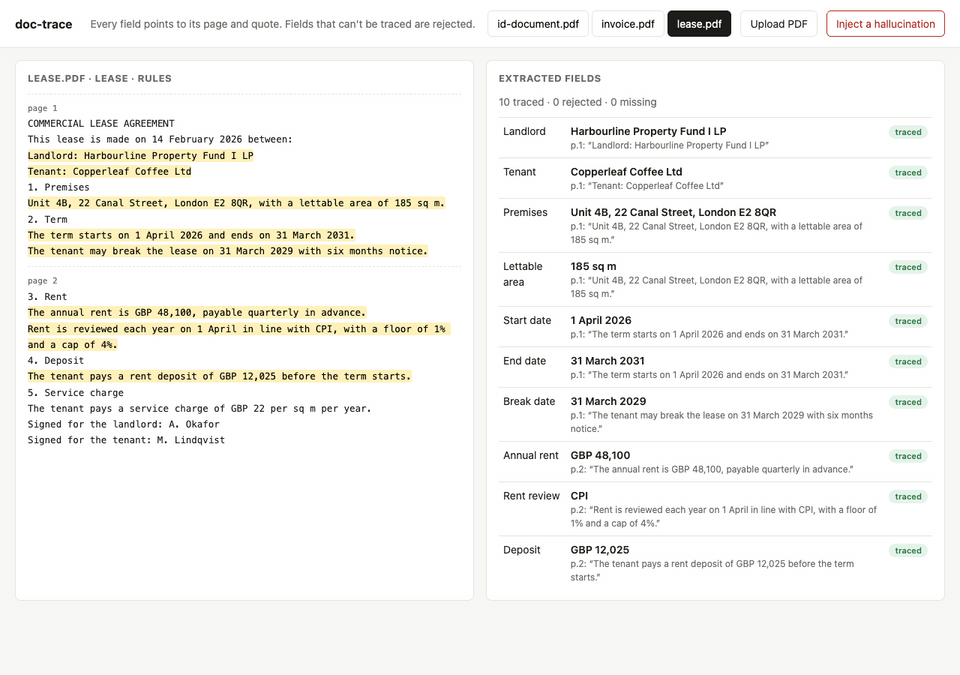

# doc-trace

Extract fields from real estate documents, and accept a field only when it points to the page and the exact quote it came from.



Leases, invoices and ID documents arrive as PDFs. A model can read them, but a fund controller can't sign off on a number they can't check. doc-trace asks the extractor for three things per field: the value, the page and the quote. Then it checks them itself. If the quote isn't on that page, or the value isn't in the quote, the field is rejected.

The check doesn't trust the extractor. It works the same for the offline rules and for an LLM.

## Run it

```sh
npm install
npm start          # http://localhost:3000
```

No API key is needed. The app opens with three synthetic PDFs (a lease, a supplier invoice and a specimen ID). Click a field to jump to its quote. Click **Inject a hallucination** to change one value the way a model might invent it, and watch the check reject it.

From the command line:

```sh
npx doc-trace samples/lease.pdf
✓ Annual rent      GBP 48,100        p.2 "The annual rent is GBP 48,100, payable quarterly in advance."
✓ Break date       31 March 2029     p.1 "The tenant may break the lease on 31 March 2029 with six months notice."
...
```

The command exits with code 1 when any field is rejected, so you can use it in a pipeline.

## Use an LLM

Without a key, doc-trace uses offline rules that cover the sample formats. Set a key to extract any document with a model:

```sh
XAI_API_KEY=... npm start                  # Grok, the default
LLM_API_KEY=... LLM_BASE_URL=https://api.openai.com/v1 LLM_MODEL=gpt-4.1 npm start
```

Any OpenAI-compatible chat API works. The default model is `grok-4`; set `LLM_MODEL` to change it. Force a mode with `--rules` or `--llm` on the command line.

## Use it as a library

```js
import { processPdf } from 'doc-trace';
const { type, fields } = await processPdf(pdfBytes, { schemas: mySchemas }); // schemas is optional
```

`fields` is a list of `{ key, label, value, page, quote, status, reason }`. Pass your own `schemas` (same shape as `src/schemas.js`) to extract other document types.

## How the check works

`src/trace.js` is the whole rule:

| Check | Result when it fails |
|---|---|
| The value is empty | `missing` |
| The page number exists | `rejected: page N does not exist` |
| The quote appears on that page | `rejected: quote not found on page N` |
| The value appears inside the quote | `rejected: value is not in the quote` |

Whitespace is normalised before the comparison, because PDF text extraction breaks lines in unpredictable places. Nothing else is fuzzy.

## Layout

```
src/pdf.js            PDF bytes → text per page (unpdf)
src/schemas.js        fields per document type, and type detection
src/extract/rules.js  offline extractor
src/extract/llm.js    LLM extractor (OpenAI-compatible, Grok by default)
src/trace.js          the check
src/server.js         local web app
samples/make.js       generates the synthetic PDFs
```

## Tests

```sh
npm test
```

The tests cover the check itself, the three samples end to end, and the LLM path with a fake model that invents one total.

## Limits

- Text PDFs only. A scanned PDF needs OCR first.
- The offline rules only know the sample layouts. Real documents need the LLM mode.
- Every name, address and number in `samples/` is made up.

## License

MIT
